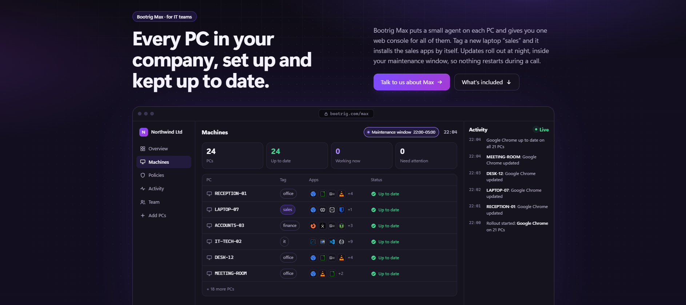

# Bootrig

Bootrig sets up a new Windows PC from one download, so you don't have to install every app by hand.
Live site: https://bootrig.com

## How it works
- You pick your apps on the website. There are over 300 to choose from.
- You download a small installer written in C# on .NET Framework 4.8, which every Windows 10/11 PC already has.
- Before it does anything, the installer downloads a digitally signed install plan and checks the signature. If someone tampered with the plan, it stops.
- The apps come through WinGet, straight from each publisher. WinGet checks every file against its SHA-256 hash, so a swapped file won't install.
- You get one admin (UAC) prompt, then everything installs in the background. Apps you already have get skipped.

## For IT teams (in development)
The team version adds a web console where admins set an app baseline for each team. Managed PCs get app updates automatically on a schedule. It also has role-based access and an audit log, and you roll it out through Intune, Group Policy or an RMM tool.

## Screenshots

The source code is private, but I can show you how it works in an interview.
